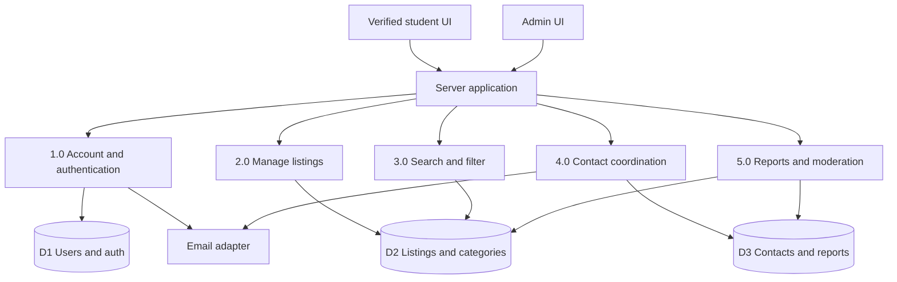

# Proposed architecture

The source requires client, application and data layers, not a specific language or framework (S2 p. 2; S3 pp. 5, 9, 12).

## Default implementation direction

The local implementation adopts the existing single TypeScript React/Next.js application, PostgreSQL, Prisma migrations and Better Auth email verification. Exact pinned versions are in package.json and pnpm-lock.yaml; D03 records adoption and official-documentation checks. This is a local technical decision, not institutional procurement approval. There are no microservices or payment adapters.

Keep provider adapters for mail and session/auth integration. Use a local mail sink in development and a configured sender in staging/production. No payment adapter exists. Optional image storage should be deferred unless authorized.

D1-D3 can be logical table groups in one PostgreSQL database. They are not three separately deployed services.

## Module responsibilities

- Access: approved-domain policy, mailbox verification, secure sessions, active status, student/admin authorization.
- Listings: validation, ownership, lifecycle and persistence.
- Discovery: bounded text search, combined filters, pagination and stable ordering.
- Contact: recipient derivation, durable contact request, participant-only retrieval, notification outcome.
- Moderation: reports, review, removal, user suspension/reactivation and immutable audit context.

Request flow: parse -> authenticate -> check active account and required privilege -> validate -> load authorized resource -> transactional change -> safe response -> record relevant audit/notification outcome. Every server entry point applies the same rules; UI gating alone is insufficient.

## Consistency and failures

Persist contact before notification; failed mail must not erase the record or falsely claim delivery. Use an idempotency mechanism to avoid duplicate interest on retries. Moderate listing and resolve report atomically. Changes to removed listings or already resolved reports return an explicit conflict. Suspended accounts lose access even with an existing session.

Prefer soft deletion/tombstones for listings referenced by contacts/reports. Public catalogue queries always exclude deleted/removed records. User-facing availability is independent of moderation state. Never infer payment completion from a listing status.

## Suggested future layout

Application routes/UI; domain services grouped by the five modules; centralized server authorization and validation; database schema/migrations; mail/auth adapters; unit/integration/browser tests. Choose concrete folders during bootstrap and document them in README.md. These modules now live under `src/app`, `src/components`, `src/lib/domain`, `src/lib/mail`, `prisma`, `scripts` and `tests`.
